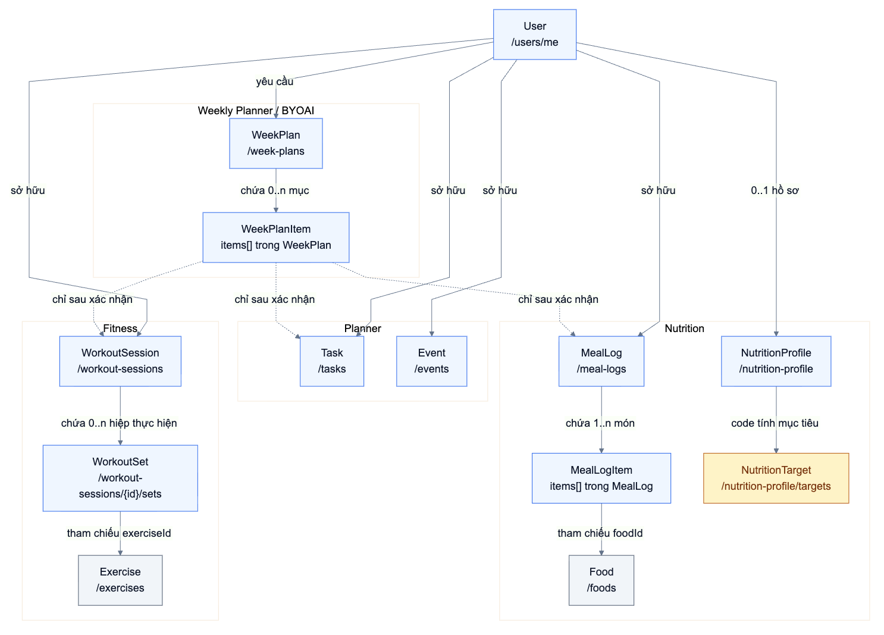
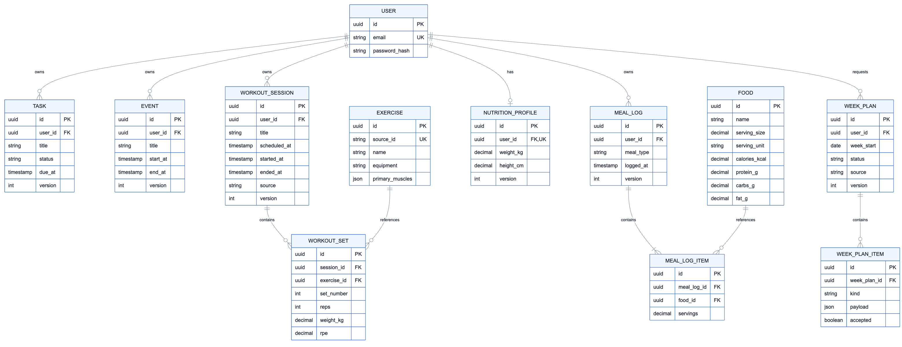

# Thiết kế Resource Model và Database Schema

## 1. Resource Model

Resource Model mô tả các tài nguyên được cung cấp thông qua API và mối quan hệ giữa chúng.

Các tài nguyên chính của hệ thống:

| Module | Resource |
| --- | --- |
| Identity | User |
| Planner | Task, Event |
| Fitness | Exercise, WorkoutSession, WorkoutSet |
| Nutrition | Food, MealLog, MealLogItem, NutritionProfile, NutritionTarget |
| Weekly Planner | WeekPlan, WeekPlanItem |

Exercise và Food là tài nguyên dùng chung. Các tài nguyên như Task, Event, WorkoutSession và MealLog thuộc về từng người dùng.

WeekPlan chứa các đề xuất về công việc, tập luyện và dinh dưỡng. Các đề xuất chỉ được chuyển thành bản ghi nghiệp vụ sau khi người dùng xác nhận.

## 2. Entity Relationship Diagram (ERD)

ERD mô tả cấu trúc dữ liệu và mối quan hệ giữa các bảng trong database.

Các quan hệ chính:

- User và Task: 1:N.
- User và Event: 1:N.
- User và WorkoutSession: 1:N.
- WorkoutSession và WorkoutSet: 1:N.
- Exercise và WorkoutSet: 1:N.
- User và MealLog: 1:N.
- MealLog và MealLogItem: 1:N.
- Food và MealLogItem: 1:N.
- User và NutritionProfile: 1:0..1.
- User và WeekPlan: 1:N.
- WeekPlan và WeekPlanItem: 1:N.

Một WorkoutSession có thể chưa có WorkoutSet khi vừa được tạo. Tương tự, một WeekPlan có thể chưa có WeekPlanItem khi đang được xử lý.

Các bảng sử dụng UUID làm khóa chính và khóa ngoại để thể hiện quan hệ giữa các bảng.

## 3. Sự khác nhau giữa Resource Model và Database Schema

| Resource Model | Database Schema |
| --- | --- |
| Mô tả tài nguyên thông qua API | Mô tả cách lưu trữ dữ liệu |
| Sử dụng URI và JSON | Sử dụng bảng, cột, PK và FK |
| Tên thuộc tính sử dụng camelCase | Tên cột sử dụng snake_case |
| Có thể chứa dữ liệu lồng nhau | Dữ liệu được tổ chức thành các bảng |
| Có thể chứa dữ liệu tính toán | Lưu dữ liệu cần thiết cho hệ thống |

Ví dụ:

- WorkoutSession trả về danh sách sets trong JSON, nhưng database lưu WorkoutSession và WorkoutSet thành hai bảng riêng.
- NutritionTarget được tính từ NutritionProfile nên không cần bảng riêng.
- totalVolumeKg được tính từ các WorkoutSet nên không cần lưu trực tiếp trong database.
- password_hash được lưu trong bảng User nhưng không trả về thông qua API.

Resource Model không nhất thiết phải ánh xạ 1:1 với Database Schema.

## 4. Thiết kế Fitness

### 4.1. Các resource chính

| Resource | Mô tả |
| --- | --- |
| Exercise | Thông tin bài tập trong thư viện dùng chung |
| WorkoutSession | Thông tin một buổi tập của người dùng |
| WorkoutSet | Thông tin một hiệp tập đã thực hiện |

Mỗi WorkoutSet thuộc về một WorkoutSession và tham chiếu đến một Exercise.

Exercise sử dụng UUID làm định danh trong hệ thống và sourceId để ánh xạ với dữ liệu từ thư viện nguồn.

### 4.2. API Endpoints

| Method | Endpoint | Chức năng | Status |
| --- | --- | --- | --- |
| GET | `/exercises` | Lấy danh sách bài tập | 200 |
| GET | `/exercises/{id}` | Xem chi tiết bài tập | 200 |
| GET | `/workout-sessions` | Lấy danh sách buổi tập | 200 |
| POST | `/workout-sessions` | Tạo buổi tập | 201 |
| GET | `/workout-sessions/{id}` | Xem chi tiết buổi tập | 200 |
| PATCH | `/workout-sessions/{id}` | Cập nhật buổi tập | 200 |
| POST | `/workout-sessions/{id}/sets` | Thêm hiệp tập | 201 |

API sử dụng tiền tố `/api/v1`.

Các API danh sách hỗ trợ phân trang, lọc và sắp xếp.

### 4.3. Validation

- Exercise ID phải đúng định dạng UUID và tồn tại trong thư viện.
- reps là số nguyên lớn hơn hoặc bằng 1.
- weightKg lớn hơn hoặc bằng 0. Bài tập không sử dụng tạ có weightKg bằng 0.
- rpe có giá trị từ 1 đến 10 hoặc null.
- endedAt không được trước startedAt.
- setNumber không được trùng trong cùng một buổi tập.
- Không thêm WorkoutSet khi buổi tập chưa bắt đầu.

### 4.4. Buổi tập dự kiến và buổi tập thực tế

Buổi tập được tạo thủ công có source là manual và có thời điểm startedAt.

Buổi tập được tạo từ kế hoạch tuần có source là week-plan, có scheduledAt nhưng startedAt bằng null.

Khi người dùng bắt đầu tập, API PATCH được sử dụng để cập nhật startedAt. Sau đó người dùng mới có thể thêm các hiệp tập đã thực hiện.

Không sử dụng số hiệp hoặc số reps dự kiến để tính kết quả tập luyện thực tế.

### 4.5. Tính tổng khối lượng tập luyện

Tổng khối lượng tập luyện của một buổi được tính theo công thức:

`totalVolumeKg = Σ(reps × weightKg)`

Ví dụ: Một hiệp tập 10 reps với mức tạ 50 kg có volume là 500 kg.

Giá trị này được backend tính từ các WorkoutSet, không lưu thành một cột riêng trong database.

## 5. Authentication và Authorization

API sử dụng JWT để xác thực người dùng.

WorkoutSession thuộc về một người dùng. WorkoutSet kế thừa quyền sở hữu từ WorkoutSession nên không cần lưu thêm userId.

Backend lấy thông tin người dùng từ JWT thay vì nhận userId trong request body.

Nếu tài nguyên không tồn tại hoặc không thuộc người dùng hiện tại, API trả về 404.

## 6. ETag và If-Match

WorkoutSession có thuộc tính version để quản lý phiên bản dữ liệu.

Khi tạo buổi tập, version được khởi tạo bằng 1. Khi cập nhật buổi tập hoặc thêm hiệp, version tăng lên.

API trả ETag tương ứng với version hiện tại. Client sử dụng If-Match khi gửi request cập nhật.

Ví dụ:

- Client nhận ETag: "1".
- Client gửi request với If-Match: "1".
- Nếu version không thay đổi, server thực hiện cập nhật và trả ETag: "2".
- Nếu version đã thay đổi, server trả 412.
- Nếu thiếu If-Match, server trả 428.

Cơ chế này giúp tránh ghi đè dữ liệu khi có nhiều request cập nhật đồng thời.

Khi thêm WorkoutSet, việc kiểm tra version, thêm hiệp và cập nhật WorkoutSession phải được thực hiện trong cùng một transaction.

Theo thiết kế, database dùng `UNIQUE(session_id, set_number)` để mỗi hiệp có một số thứ tự riêng trong buổi tập.

`POST /workout-sessions` chưa hỗ trợ `Idempotency-Key`. Nếu không nhận được phản hồi, client cần kiểm tra lịch sử tập luyện trước khi gửi lại yêu cầu tạo buổi.

## 7. OpenAPI và Mock Server

API được thiết kế theo phương pháp Design-first bằng OpenAPI 3.0.3.

Các file Fitness:

- `api/paths/fitness.yaml`: định nghĩa endpoint, method, parameter và response.
- `api/schemas/fitness.yaml`: định nghĩa cấu trúc và ràng buộc dữ liệu.
- `api/examples/fitness.yaml`: dữ liệu request và response mẫu.

Các schema, parameter và response lỗi dùng chung được tham chiếu từ `api/components.yaml`.

Công cụ sử dụng:

- Spectral: kiểm tra OpenAPI Specification.
- Redocly: gộp các file OpenAPI.
- Swagger UI: hiển thị tài liệu và gửi request.
- Prism: mô phỏng API dựa trên OpenAPI.

Trong Tuần 12, hệ thống mới hoàn thành phần thiết kế API và mock server. Các chức năng lưu trữ, xác thực, phân quyền và xử lý transaction thực tế sẽ được triển khai khi xây dựng backend.

## 8. Phạm vi triển khai tiếp theo

- Triển khai Fitness API bằng FastAPI và PostgreSQL.
- Kiểm tra validation, quyền sở hữu và cập nhật đồng thời.
- Tích hợp Fitness với Weekly Planner, sử dụng UUID để tham chiếu Exercise.
- Kiểm tra cấu trúc payload trước khi chấp nhận kế hoạch tuần.
- Virtual Trainer là tính năng mở rộng ngoài MVP. Nhóm sẽ xem xét thử nghiệm cục bộ sau khi hoàn thành luồng Fitness chính.
