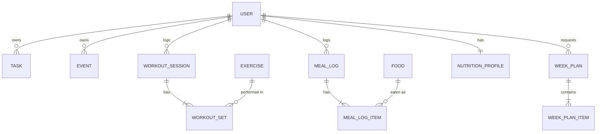

# Kế hoạch dự án UP (bám yêu cầu Tuần 12–15, môn SOA)

Nhóm: Dũng, Hiếu, Cảnh.
Trạng thái: kế hoạch, chưa có code backend. Lộ trình dài hạn đầy đủ (thu chi, học tập, video pose...) nằm ở [plan-roadmap.md](plan-roadmap.md).

Mục tiêu chính của bài tập lớn: **áp dụng kiến thức các bài giảng SOA vào một API thật**. Vì vậy phạm vi MVP được giữ nhỏ, và mỗi quyết định thiết kế đều gắn với một bài học.

## 1. Bài toán và người dùng

**Vấn đề.** Người dùng cá nhân phải dùng nhiều app rời rạc cho công việc, tập luyện và ăn uống. Các app này không biết nhau: lịch tập không tính tới lịch làm việc, thực đơn không tính tới ngày tập nặng.

**Giá trị.** UP gom các mảng này sau một API thống nhất, rồi dùng LLM lên **kịch bản tuần** hợp nhất việc, tập, ăn. LLM chỉ đề xuất bản nháp, người dùng xác nhận.

**API consumers**
1. Frontend UP (web, JS thuần, đã có trong `docs/`). Consumer chính.
2. `ai-service` gọi các service dữ liệu để dựng ngữ cảnh cho LLM. Consumer nội bộ.
3. Ngoài MVP: app di động, công cụ nhập dữ liệu từ bên thứ ba.

## 2. Use case

| # | Use case | Mức |
| --- | --- | --- |
| UC1 | Đăng ký, đăng nhập, giữ phiên | MVP |
| UC2 | Quản lý công việc và sự kiện trong lịch | MVP |
| UC3 | Ghi buổi tập (bài, hiệp, kg, số lần) và xem lịch sử | MVP |
| UC4 | Ghi bữa ăn, xem tổng kcal và macro so với mục tiêu | MVP |
| UC5 | **Lên kịch bản tuần**: LLM sinh bản nháp, người dùng xem, nhận hoặc từ chối | MVP, **luồng demo trọng tâm** |

**Ngoài MVP** (ghi rõ trong slide để đạt tiêu chí "ranh giới rõ"): thu chi, học tập và flashcard, video pose realtime, nhập CSV, thông báo đẩy, nhiều người dùng chia sẻ dữ liệu.

## 3. Luồng demo trọng tâm (UC5)

Từ góc nhìn consumer, chạy được trên mock server, không cần database thật:

1. `POST /auth/login` nhận token.
2. `POST /week-plans` với `{ "weekStart": "2026-12-07", "goals": {...} }` trả `202` kèm bản nháp `status: "draft"`. (Mock trả bản nháp cố định.)
3. `GET /week-plans/{id}` xem các mục của bản nháp (task, buổi tập, bữa ăn theo ngày).
4. `POST /week-plans/{id}:accept` nhận toàn bộ hoặc theo danh sách `itemIds`, hệ thống tạo task, workout-session kế hoạch, meal-log kế hoạch.
5. Ca lỗi minh họa: `401` thiếu token, `404` không có plan, `409` plan đã nhận hoặc ETag cũ, `422` mục vi phạm ràng buộc (trùng giờ).

Ba operation quan trọng nhất để demo: `POST /auth/login`, `POST /week-plans`, `POST /week-plans/{id}:accept`.

## 4. Resource model

Resource là khái niệm mà consumer nhìn thấy. Bảng database có thể khác (xem mục 5).

| Resource | Đường dẫn | Ghi chú |
| --- | --- | --- |
| User | `/users/me` | Chỉ có "tôi", không liệt kê người khác |
| Task | `/tasks`, `/tasks/{id}` | Lọc theo `status`, `dueFrom`, `dueTo` |
| Event | `/events`, `/events/{id}` | Lọc theo `date` |
| Exercise | `/exercises`, `/exercises/{id}` | Chỉ đọc, dữ liệu 939 bài đã có |
| WorkoutSession | `/workout-sessions/{id}` | Chứa `sets` |
| WorkoutSet | `/workout-sessions/{id}/sets` | Lồng một cấp |
| Food | `/foods`, `/foods/{id}` | Chỉ đọc, tìm theo tên |
| MealLog | `/meal-logs/{id}` | Chứa `items` (food, khẩu phần) |
| NutritionProfile | `/nutrition-profile` | Một bản ghi duy nhất cho mỗi người dùng |
| NutritionTarget | `/nutrition-profile/targets` | Giá trị tính ra từ hồ sơ, chỉ đọc |
| WeekPlan | `/week-plans`, `/week-plans/{id}` | Bản nháp do LLM sinh, có `items` |

Quy tắc đặt tên: danh từ số nhiều, `kebab-case` trong URL, `camelCase` trong JSON, thời gian ISO 8601 UTC, ID dạng UUID, tiền không có trong MVP. Hành động không thuần CRUD dùng hậu tố `:động_từ` (`:accept`).

## 5. ERD và khác biệt với resource model



Khác biệt cần giải thích trong slide:
- `NutritionTarget` là resource nhưng **không có bảng**: tính từ `NutritionProfile` bằng công thức mỗi lần gọi.
- `WeekPlan` gộp nhiều loại mục (task, buổi tập, bữa ăn) thành một danh sách. Trong DB, `WEEK_PLAN_ITEM` có cột `kind` và `payload` JSON, còn khi `:accept` thì tách ra các bảng thật.
- Tổng kcal, tổng khối lượng tập là trường tính ra, không lưu.
- `User` trong DB có mật khẩu băm, resource `/users/me` không bao giờ trả trường đó.
- Mọi bảng có `user_id`, `created_at`, `updated_at`, `version`. Khóa ngoại và bảng nối không lộ ra consumer.

## 6. Kiến trúc và công nghệ

```
Frontend UP (JS thuần, GitHub Pages)
        │ HTTPS, JWT
        ▼
   API (Flask, /api/v1)         ← một process cho MVP
   ├─ Blueprint identity
   ├─ Blueprint planner   (task, event)
   ├─ Blueprint fitness   (exercise, workout)
   ├─ Blueprint nutrition (food, meal-log, profile)
   └─ Blueprint plans     (week-plan) ──▶ LLM adapter ──▶ Gemini API
        │
   PostgreSQL (SQLite khi chạy local/test)
```

| Hạng mục | Lựa chọn | Lý do và đánh đổi |
| --- | --- | --- |
| Backend | Flask, application factory, Blueprint, SQLAlchemy 2.x, Marshmallow, Flask-Migrate | Đã làm ở Tuần 7, nhóm quen tay |
| Cơ sở dữ liệu | PostgreSQL, SQLite cho test | Theo Tuần 7 |
| Triển khai | Docker Compose, `/healthz`, `/ready` | Theo Tuần 7 |
| Hợp đồng | OpenAPI 3.x viết tay trước (design-first), Swagger UI | Tuần 4. Cần hơn code-first vì tuần này chỉ có hợp đồng |
| Mock | Prism (`prism mock openapi.yaml`) | Chạy thẳng từ spec, không viết backend |
| Kiểm thử | Spectral (lint spec), pytest, Postman/Newman, k6 hoặc tương đương | Tuần 8 |
| Xác thực | JWT truy cập sống ngắn, refresh token, mỗi bản ghi thuộc `user_id` | Tuần 6 |
| LLM | Gemini API (khóa từ Google AI Studio), gọi từ backend, đầu ra JSON theo schema. Tên model và giá chốt ở Tuần 14 sau khi kiểm tra tài liệu hiện hành | Khóa không bao giờ ở frontend hay trong repo (`.env`, không commit) |

**Đánh đổi chính (nội dung slide):**
- *Modular monolith thay vì microservice*: 3 người, 4 tuần. Mỗi module là Blueprint có model riêng, không import chéo model, nên tách service sau này chỉ cần đổi cách gọi. Đổi lại: chưa chứng minh được triển khai độc lập.
- *LLM bất đồng bộ*: tạo kế hoạch trả `202` và bản nháp `draft`, client hỏi lại bằng `GET`, tránh giữ kết nối lâu.
- *LLM chỉ đề xuất*: không ghi dữ liệu trực tiếp, chỉ `:accept` mới ghi. Đổi lại: thêm một bước cho người dùng.
- *Số liệu dinh dưỡng do code tính*, không để LLM tính.

## 7. API contract (tóm tắt, bản đầy đủ nằm trong `api/openapi.yaml`)

Tiền tố `/api/v1`. Mọi endpoint (trừ đăng ký, đăng nhập) cần `Authorization: Bearer <jwt>`.

| Method | Path | Mô tả | Thành công | Lỗi chính |
| --- | --- | --- | --- | --- |
| POST | `/auth/register` | Đăng ký | 201 | 409, 422 |
| POST | `/auth/login` | Đăng nhập | 200 | 401, 422 |
| POST | `/auth/refresh` | Đổi token | 200 | 401 |
| GET, POST | `/tasks` | Danh sách, tạo | 200, 201 | 401, 422 |
| GET, PATCH, DELETE | `/tasks/{id}` | Chi tiết, sửa (có `If-Match`), xóa | 200, 204 | 404, 412 |
| GET, POST | `/events` | Danh sách, tạo | 200, 201 | 401, 422 |
| GET | `/exercises` | Thư viện, lọc nhóm cơ, dụng cụ | 200 | 401 |
| GET, POST | `/workout-sessions` | Danh sách, tạo buổi tập | 200, 201 | 422 |
| POST | `/workout-sessions/{id}/sets` | Thêm hiệp | 201 | 404, 422 |
| GET | `/foods?q=` | Tìm thực phẩm | 200 | 401 |
| GET, POST | `/meal-logs` | Nhật ký ăn | 200, 201 | 422 |
| GET, PUT | `/nutrition-profile` | Hồ sơ dinh dưỡng | 200 | 422 |
| GET | `/nutrition-profile/targets` | Mục tiêu kcal, macro | 200 | 404 |
| POST | `/week-plans` | Yêu cầu bản nháp | 202 | 422, 429 |
| GET | `/week-plans/{id}` | Xem bản nháp | 200 | 404 |
| POST | `/week-plans/{id}:accept` | Nhận bản nháp | 200 | 404, 409, 422 |

Quy ước chung (mỗi mục gắn với bài học):
- **Lỗi** theo RFC 7807 (`application/problem+json`): `type`, `title`, `status`, `detail`, `instance`, kèm `errors[]` khi lỗi kiểm tra dữ liệu. (Tuần 2)
- **Danh sách**: `page`, `size` (tối đa 100), `sort=-createdAt`, lọc theo trường. Trả `items`, `page`, `size`, `total`. (Tuần 5)
- **Cập nhật an toàn**: `ETag` ở `GET`, `If-Match` ở `PATCH`/`PUT`, sai trả `412`. (Tuần 2)
- **Xác thực, phân quyền**: JWT Bearer, truy cập tài nguyên của người khác trả `404`, không trả `403`, để không lộ sự tồn tại. (Tuần 6)
- **Phiên bản**: URI `/api/v1`. Quy tắc: thêm trường tùy chọn không đổi phiên bản, đổi tên hoặc bỏ trường, đổi kiểu phải lên `v2`. (Tuần 9)
- **Giới hạn tốc độ**: `429` kèm `Retry-After` cho `/week-plans` vì tốn tiền LLM. (Tuần 6)

## 8. Phân công Tuần 12

**Hạn: hết ngày 25/11/2026 (ngày mai).** Phân việc theo mảng cho đều khối lượng, không theo thế mạnh. Mọi PR cần một người khác duyệt, để ai cũng giải thích được toàn bộ thiết kế khi giảng viên hỏi.

### 8.1 Sở hữu dài hạn (Tuần 13–15)

| Thành viên | Sở hữu |
| --- | --- |
| **Cảnh** | identity, planner (task, event), khung `openapi.yaml`, lỗi, phân trang, ETag, CI (Spectral) |
| **Dũng** | fitness, nối frontend `docs/` với API, Swagger UI/mock |
| **Hiếu** | nutrition, week-plans, LLM adapter (Gemini API), prompt, kiểm tra schema đầu ra |

### 8.2 Quy tắc làm việc chung

- Một nhánh Git cho mỗi người (`canh/week12`, `dung/week12`, `hieu/week12`), gộp vào `main` bằng PR, người khác duyệt.
- `api/openapi.yaml` chỉ chứa khung và `$ref` tới file con. Mỗi người sửa **file riêng** để không xung đột:
  - `api/components.yaml` (Cảnh): Problem, Pagination, security, tham số chung
  - `api/paths/auth-planner.yaml` (Cảnh)
  - `api/paths/fitness.yaml` (Dũng)
  - `api/paths/nutrition-plans.yaml` (Hiếu)
- Nếu Swagger UI hoặc Prism không đọc được `$ref` ngoài, gộp một file bằng `npx @redocly/cli bundle` (việc của Cảnh).
- Quy ước đặt tên theo mục 4 và 7. Cảnh đăng `components.yaml` trước, hai người còn lại dùng lại, không tự định nghĩa lại kiểu lỗi.
- Mỗi mục "đã xong" gắn link commit/PR hoặc ảnh chụp để làm bằng chứng cho báo cáo.

### 8.3 Việc từng người (hạn 25/11)

**Cảnh**
| # | Việc | Sản phẩm | Khi nào |
| --- | --- | --- | --- |
| C1 | Dựng cấu trúc repo (mục 11), `api/openapi.yaml` khung, `api/components.yaml` (Problem, Pagination, Bearer JWT, tham số `page`/`size`/`sort`) rồi đẩy lên cho cả nhóm | Commit đầu tiên của spec | Sáng, trước 10:00 |
| C2 | Viết OpenAPI: `/auth/*`, `/tasks`, `/tasks/{id}` (có `ETag`, `If-Match`), `/events` | `api/paths/auth-planner.yaml` | Sáng, xong trước 13:00 |
| C3 | Cài Spectral, thêm ruleset và workflow GitHub Actions chạy lint | `.spectral.yaml`, CI xanh | Chiều |
| C4 | Chạy `prism mock`, kiểm 3 operation demo, chụp ảnh | Ảnh và lệnh chạy trong README | Chiều, sau khi có cả 3 file paths |
| C5 | Viết `design/brief.md` (1–2 trang) từ mục 1–3 của plan này | Brief | Chiều |
| C6 | Phụ trách slide: bài toán, MVP, tiêu chuẩn API (lỗi, phân trang, ETag, auth, version) | 2 slide | Tối |

**Dũng**
| # | Việc | Sản phẩm | Khi nào |
| --- | --- | --- | --- |
| D1 | Tạo hoặc chuyển repo nộp bài, bật nhánh, mời Hiếu và Cảnh, đặt README khung, tạo GitHub Issues và Project (backlog mục 10), gán người và nhãn tuần | Repo, backlog | Sáng, trước 10:00 |
| D2 | Viết OpenAPI: `/exercises`, `/workout-sessions`, `/workout-sessions/{id}/sets` (dùng `components.yaml` của Cảnh) | `api/paths/fitness.yaml` | Sáng và đầu chiều |
| D3 | Vẽ sơ đồ resource model (bảng mục 4 thành hình) và ERD (mermaid mục 5, xuất ảnh) | `design/resource-model.*`, `design/erd.*` | Chiều |
| D4 | Viết `design/design.md`: giải thích resource model khác DB schema (từ mục 5) | Tài liệu thiết kế | Chiều |
| D5 | Dựng Swagger UI hiển thị `openapi.yaml` (HTML tĩnh tải `swagger-ui-dist`) và kiểm tra mở được | `api/index.html` hoặc ảnh chụp | Chiều, sau khi có spec |
| D6 | Phụ trách slide: resource model, ERD, khác biệt với DB | 2 slide | Tối |

**Hiếu**
| # | Việc | Sản phẩm | Khi nào |
| --- | --- | --- | --- |
| H1 | Viết OpenAPI: `/foods`, `/meal-logs`, `/nutrition-profile`, `/nutrition-profile/targets` | Một phần của `api/paths/nutrition-plans.yaml` | Sáng |
| H2 | Viết OpenAPI: `/week-plans`, `/week-plans/{id}`, `/week-plans/{id}:accept`, có `202`, `409`, `422`, `429` và ví dụ response bản nháp cố định cho mock | Phần còn lại của file đó | Sáng và đầu chiều |
| H3 | Vẽ sơ đồ kiến trúc (mục 6) và sơ đồ tuần tự luồng UC5 (mermaid sequence) | `design/architecture.*`, `design/uc5-sequence.*` | Chiều |
| H4 | Viết mục lựa chọn LLM: Gemini API, cách gọi từ backend, đầu ra JSON theo schema, giữ khóa trên server, giới hạn tốc độ. Chưa cần khóa thật | Đoạn trong `design/design.md`, một slide | Chiều |
| H5 | Viết `reports/report-T12.md` (1–2 trang): đã làm, chưa xong, cần hỗ trợ, kế hoạch tuần 13–15, người chịu trách nhiệm. Gom link bằng chứng của cả nhóm | Báo cáo | Chiều tối |
| H6 | Phụ trách slide: kiến trúc, luồng UC5 và LLM, kế hoạch tuần 13–15 và rủi ro | 2–3 slide | Tối |

**Cả nhóm (cuối ngày)**
| # | Việc | Khi nào |
| --- | --- | --- |
| G1 | Họp 15 phút đầu ngày: chốt MVP 5 use case và luồng UC5 | Đầu ngày |
| G2 | Duyệt chéo spec: chạy Spectral, kiểm tên trường và mã lỗi nhất quán giữa 3 file | Chiều |
| G3 | Ghép slide (6–8), luyện demo: mở Swagger UI hoặc Prism, 3 operation và luồng UC5. Mỗi người tập trả lời câu hỏi về cả bản thiết kế | Tối |
| G4 | Nộp: slide, link repo, OpenAPI/Swagger, báo cáo, bằng chứng | Trước hạn |

### 8.4 Phụ thuộc cần để ý

- C1 phải xong sớm vì D2, H1, H2 dùng `components.yaml`. Nếu C1 trễ, hai người kia viết trước với `$ref` giả rồi sửa lại.
- C4 và D5 cần cả 3 file paths, nên là việc buổi chiều.
- H5 cần bằng chứng của mọi người, nên làm gần cuối.
- Cắt nếu thiếu giờ: bỏ D5 (dùng Swagger Editor trực tuyến để chụp ảnh), rút gọn C3 (chạy Spectral tay, chưa cần CI).

## 9. Kế hoạch Tuần 12–15

| Tuần | Mục tiêu | Sản phẩm kiểm được | Người chính |
| --- | --- | --- | --- |
| **12 (thiết kế)** | Brief, resource model, ERD, kiến trúc, `openapi.yaml`, Swagger UI hoặc mock, repo, backlog, slide | Spectral không lỗi, `prism mock` trả đúng 3 operation demo, 6–8 slide, báo cáo 1–2 trang | Cả nhóm |
| **13 (nền tảng)** | Backend khung: factory, DB, migration, Docker Compose, `/healthz`, `/ready`, identity (đăng ký, đăng nhập, refresh), planner CRUD | `docker compose up` chạy, pytest xanh, Newman chạy trên auth và tasks | Cảnh, Dũng |
| **14 (nghiệp vụ)** | fitness, nutrition (có công thức mục tiêu), week-plans với LLM adapter (có nhà cung cấp giả), `:accept`, frontend gọi API thật | Luồng UC5 chạy từ frontend, test phân quyền "A không đọc được dữ liệu của B" | Dũng, Hiếu |
| **15 (hoàn thiện)** | Versioning, thử tải, rà soát bảo mật, gọi LLM thật, sửa lỗi, tài liệu, slide cuối | Báo cáo kiểm thử, kết quả tải, demo trọn vẹn | Cả nhóm |

**Cắt giảm nếu trễ (theo thứ tự):** gọi LLM thật (giữ nhà cung cấp giả), frontend nối API (demo bằng Swagger), nutrition (giữ planner và fitness).

## 10. Backlog khởi tạo (đưa vào GitHub Issues, nhãn theo tuần và người)

**Tuần 12**
- [ ] Viết `docs/brief.md` (1–2 trang)
- [ ] Vẽ resource model và ERD, viết đoạn khác biệt resource/DB
- [ ] Vẽ sơ đồ kiến trúc và sơ đồ luồng UC5
- [ ] `api/openapi.yaml`: components dùng chung (Problem, Pagination, Auth)
- [ ] OpenAPI: auth, tasks, events
- [ ] OpenAPI: exercises, workout-sessions
- [ ] OpenAPI: nutrition, meal-logs, week-plans
- [ ] Spectral lint chạy trong CI
- [ ] Prism mock và/hoặc Swagger UI trên GitHub Pages
- [ ] README: mục tiêu, cách chạy mock, cấu trúc repo, phân công
- [ ] Slide 6–8 và báo cáo tiến độ, kèm bằng chứng (commit, ảnh Swagger, kết quả lint)

**Tuần 13–15:** tạo issue ngay sau khi spec được duyệt, mỗi endpoint một issue, kèm tiêu chí hoàn thành là test và ví dụ response.

## 11. Cấu trúc repo đề xuất

```
UP/
├─ api/openapi.yaml          hợp đồng, nguồn sự thật
├─ docs/                     frontend hiện có (GitHub Pages)
├─ design/                   brief.md, resource-model, erd, architecture, hình
├─ backend/                  từ tuần 13
├─ reports/                  report-T12.md, ...
├─ plan.md, plan-roadmap.md
└─ README.md
```

Lưu ý: GitHub Pages hiện đang phục vụ thư mục `docs/`. Nếu đặt tài liệu thiết kế vào `design/` thì không lẫn vào frontend. Nếu muốn Swagger UI chạy trên Pages thì thêm vào `docs/api/` hoặc đổi thư mục Pages.

## 12. Rủi ro

| Rủi ro | Mức | Cách giảm |
| --- | --- | --- |
| Phạm vi lớn so với 3 người, 4 tuần | Cao | MVP chỉ 5 use case, có danh sách cắt giảm ở mục 9 |
| Chỉ một người hiểu một mảng | Cao | Mọi PR có người duyệt chéo, mỗi người trình bày một phần slide không thuộc mảng mình |
| Hợp đồng OpenAPI đổi giữa tuần 13–14 | Trung bình | Mọi đổi spec đi qua PR có cả nhóm duyệt, chạy Spectral, ghi vào CHANGELOG |
| LLM trả sai định dạng hoặc số sai | Trung bình | Kiểm tra schema, thử lại tối đa 2 lần, số dinh dưỡng do code tính, nhà cung cấp giả cho test |
| Chi phí LLM | Thấp–Trung bình | Giới hạn tốc độ, cache, chỉ gọi thật ở tuần 15 |
| Dữ liệu thực phẩm chưa có và giấy phép | Trung bình | Bắt đầu bằng 50–100 món nhóm tự nhập, kiểm giấy phép trước khi nạp bộ lớn |
| Không có bằng chứng khi báo cáo | Cao | Mỗi mục "đã xong" gắn link commit hoặc PR, ảnh response hoặc kết quả test |

## 13. Định nghĩa hoàn thành Tuần 12

- [ ] Brief, use case và ranh giới MVP được cả nhóm đồng ý
- [ ] `openapi.yaml` hợp lệ (Spectral không lỗi), có luồng UC5 và các ca lỗi, hiển thị qua Swagger UI hoặc mock
- [ ] Demo chạy được ít nhất 3 operation và luồng UC5 trên mock
- [ ] Repo có README, backlog, phân công, kế hoạch tuần 13–15
- [ ] Slide và báo cáo kèm bằng chứng; mỗi thành viên giải thích được toàn bộ thiết kế

## 14. Cần nhóm xác nhận

1. Đồng ý luồng demo UC5 (lên kịch bản tuần) và MVP 5 use case ở mục 2?
2. Phân công mục 8 đã chốt (không theo thế mạnh), hạn 25/11/2026. Giờ họp đầu ngày là mấy giờ?
4. Repo nộp bài: dùng luôn `manhdung1126/UP` hay tạo repo nhóm mới?
5. Ai tạo khóa Gemini API, và hạn mức miễn phí có đủ cho tuần 14–15 không? (Chưa cần ở Tuần 12.)
