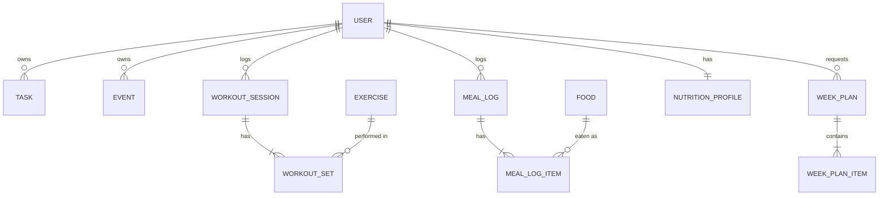

# Kế hoạch dự án UP (bám yêu cầu Tuần 12–15, môn SOA)

Nhóm: Dũng, Hiếu, Cảnh.
Trạng thái: bản cập nhật ngày **25/11/2026**, đưa trực tiếp vào `main` theo yêu cầu để nhóm đọc và góp ý; chưa phải xác nhận đã triển khai hoặc cả nhóm đã duyệt.

Hướng cập nhật: **FastAPI + BYOAI (Bring Your Own AI) + Virtual Trainer**. Giữ nguyên quyền sở hữu nghiệp vụ Dũng–Hiếu–Cảnh. Các quyết định chưa thống nhất được đánh dấu **[CHỜ NHÓM GÓP Ý]** ở mục 14.

Phạm vi nộp Tuần 12–15 lấy tài liệu này làm chuẩn. [plan-roadmap.md](plan-roadmap.md) là định hướng Super App dài hạn; bản đồng bộ FastAPI/BYOAI/Virtual Trainer đang ở [PR #2](https://github.com/manhdung1126/UP/pull/2). Finance, học tập mở rộng và camera trainer không tự trở thành yêu cầu MVP.

Mục tiêu chính của bài tập lớn: **áp dụng kiến thức các bài giảng SOA vào một API thật**. Vì vậy phạm vi MVP được giữ nhỏ, và mỗi quyết định thiết kế đều gắn với một bài học.

## 1. Bài toán và người dùng

**Vấn đề.** Người dùng cá nhân phải dùng nhiều app rời rạc cho công việc, tập luyện và ăn uống. Các app này không biết nhau: lịch tập không tính tới lịch làm việc, thực đơn không tính tới ngày tập nặng.

**Giá trị.** UP gom các mảng này sau một API thống nhất, rồi dùng LLM lên **kịch bản tuần** hợp nhất việc, tập, ăn. LLM chỉ đề xuất bản nháp, người dùng xác nhận.

**API consumers**
1. Frontend UP (web, JS thuần). `docs/` là prototype sinh bằng AI để tham khảo; frontend chính sẽ xây lại từng luồng có review và kiểm thử.
2. Module `plans` lấy dữ liệu qua hợp đồng nghiệp vụ để dựng ngữ cảnh BYOAI; connector/MCP nếu được duyệt chỉ truy cập theo quyền đã cấp.
3. Ngoài MVP: app di động, công cụ nhập dữ liệu từ bên thứ ba.

## 2. Use case

| # | Use case | Mức |
| --- | --- | --- |
| UC1 | Đăng ký, đăng nhập, giữ phiên | MVP |
| UC2 | Quản lý công việc và sự kiện trong lịch | MVP |
| UC3 | Ghi buổi tập (bài, hiệp, kg, số lần) và xem lịch sử | MVP |
| UC4 | Ghi bữa ăn, xem tổng kcal và macro so với mục tiêu | MVP |
| UC5 | **Lên kịch bản tuần**: nhận bản nháp qua BYOAI, kiểm dữ liệu, người dùng nhận hoặc từ chối; Mock Provider dùng cho demo/test | MVP, **luồng demo trọng tâm** |

**Bắt buộc:** UC1–UC5, dữ liệu lưu bền, kiểm quyền sở hữu, schema đầu ra và bước xác nhận. UC5 demo được bằng Mock Provider không có API key; báo cáo phải ghi rõ đầu ra mock. Hướng BYOAI tối thiểu là xuất prompt/ngữ cảnh và nhập JSON từ trợ lý người dùng chọn, dùng cùng quy tắc kiểm bản nháp.

**Mở rộng, [CHỜ NHÓM GÓP Ý]:** PoC Virtual Trainer cục bộ 1–2 bài, kết nối subscription chính thức, MCP hoặc Local LLM. Chỉ nhận vào sprint khi lõi MVP đạt và nhóm đồng ý.

**Ngoài MVP:** thu chi, học tập và flashcard, camera trainer tích hợp web đầy đủ, nhập CSV, thông báo đẩy, nhiều người dùng chia sẻ dữ liệu. Giữ Nutrition trong MVP; thay đổi phạm vi cần nhóm và tiêu chí môn học cho phép.

## 3. Luồng demo trọng tâm (UC5)

Tuần 12 demo hợp đồng trên Prism với dữ liệu cố định; Tuần 14–15 triển khai luồng thật. Trạng thái và operation nhập JSON dưới đây là **[CHỜ NHÓM GÓP Ý]**, Hiếu cập nhật spec qua PR sau khi duyệt.

1. `POST /auth/login` nhận token.
2. `POST /week-plans` với `{ "weekStart": "2026-12-07", "goals": {...} }` trả `202`, ID và `status: "pending"`; chưa thể nhận khi đang xử lý.
3. `GET /week-plans/{id}`: mock trả bản nháp cố định `draft`. Chế độ xuất/nhập trả `awaiting-input` kèm prompt/ngữ cảnh đã giảm dữ liệu cá nhân; người dùng tự đưa sang trợ lý AI của mình.
4. Đề xuất `POST /week-plans/{id}:import`: chỉ nhập khi `awaiting-input`; sai trạng thái trả `409`. Backend kiểm Pydantic, quyền sở hữu, ID tham chiếu và ràng buộc lịch/dinh dưỡng. Hợp lệ mới thành `draft`, sai dữ liệu trả `422`, không ghi dữ liệu nghiệp vụ.
5. `POST /week-plans/{id}:accept` nhận toàn bộ hoặc danh sách `itemIds`. Kiểm lại quyền, phiên bản và ràng buộc theo dữ liệu hiện tại, rồi gọi nghiệp vụ planner/fitness/nutrition trong transaction. Mỗi mục chỉ nhận một lần; retry không tạo bản ghi trùng.
6. Ca lỗi: `401` thiếu token, `404` không có plan hoặc khác chủ, `409` trạng thái không cho phép/đã nhận, `412` khi `If-Match` cũ, `422` dữ liệu không hợp lệ hoặc trùng giờ. Xử lý thất bại phải thành `failed` có lý do để thử lại; không để `pending` vô thời hạn.

Ba operation bắt buộc Tuần 12 vẫn là `POST /auth/login`, `POST /week-plans`, `POST /week-plans/{id}:accept`. Prism chỉ mô phỏng hợp đồng; test Tuần 14–15 mới chứng minh được chuyển trạng thái và lưu dữ liệu.

## 4. Resource model

Resource là khái niệm mà consumer nhìn thấy. Bảng database có thể khác (xem mục 5).

| Resource | Đường dẫn | Ghi chú |
| --- | --- | --- |
| User | `/users/me` | Chỉ có "tôi", không liệt kê người khác |
| Task | `/tasks`, `/tasks/{id}` | Lọc theo `status`, `dueFrom`, `dueTo` |
| Event | `/events`, `/events/{id}` | Lọc theo `date` |
| Exercise | `/exercises`, `/exercises/{id}` | Chỉ đọc, dữ liệu 939 bài đã có |
| WorkoutSession | `/workout-sessions/{id}` | Chứa `sets` |
| WorkoutSet | `/workout-sessions/{id}/sets` | Lồng một cấp |
| Food | `/foods`, `/foods/{id}` | Chỉ đọc, tìm theo tên |
| MealLog | `/meal-logs/{id}` | Chứa `items` (food, khẩu phần) |
| NutritionProfile | `/nutrition-profile` | Một bản ghi duy nhất cho mỗi người dùng |
| NutritionTarget | `/nutrition-profile/targets` | Giá trị tính ra từ hồ sơ, chỉ đọc |
| WeekPlan | `/week-plans`, `/week-plans/{id}` | Bản nháp BYOAI hoặc mock, có `items`, nguồn, trạng thái; chỉ nhận khi hợp lệ |

Quy tắc đặt tên: danh từ số nhiều, `kebab-case` trong URL, `camelCase` trong JSON, thời gian ISO 8601 UTC, ID dạng UUID, tiền không có trong MVP. Hành động không thuần CRUD dùng hậu tố `:động_từ` (`:accept`).

## 5. ERD và khác biệt với resource model



Khác biệt cần giải thích trong slide:
- `NutritionTarget` là resource nhưng **không có bảng**: tính từ `NutritionProfile` bằng công thức mỗi lần gọi.
- `WeekPlan` gộp nhiều loại mục (task, buổi tập, bữa ăn) thành một danh sách. Trong DB, `WEEK_PLAN_ITEM` có cột `kind` và `payload` JSON, còn khi `:accept` thì tách ra các bảng thật.
- Tổng kcal, tổng khối lượng tập là trường tính ra, không lưu.
- `User` trong DB có mật khẩu băm, resource `/users/me` không bao giờ trả trường đó.
- Bản ghi riêng có `user_id`, timestamp và `version`; thư viện chung exercises/foods tách khỏi dữ liệu cá nhân. Khóa ngoại và bảng nối không lộ ra consumer.

## 6. Kiến trúc và công nghệ

```
Frontend mới (JS module, từng vertical slice)
        │ HTTPS, JWT
        ▼
   FastAPI (/api/v1), Uvicorn       ← modular monolith cho MVP
   ├─ APIRouter identity
   ├─ APIRouter planner   (task, event)
   ├─ APIRouter fitness   (exercise, workout)
   ├─ APIRouter nutrition (food, meal-log, profile)
   └─ APIRouter plans     (week-plan) ──▶ BYOAI: mock / xuất-nhập
        │                                  └─ connector chính thức/local (PoC)
   SQLAlchemy 2.x + Alembic ──▶ PostgreSQL

Virtual Trainer cục bộ (PoC, ngoài lõi MVP)
Camera → MediaPipe → góc khớp/RepCounter + SVM → tóm tắt hiệp
                                             └─ người dùng duyệt → Fitness API
```

| Hạng mục | Lựa chọn | Lý do và đánh đổi |
| --- | --- | --- |
| Backend | FastAPI, APIRouter, Pydantic, SQLAlchemy 2.x, Alembic, Uvicorn | Giữ kiến thức phân lớp Tuần 7; cần học dependency injection, validation và migration của stack mới |
| Cơ sở dữ liệu | PostgreSQL; SQLite chỉ cho test đơn vị phù hợp | Migration, transaction và test tích hợp/cạnh tranh cập nhật phải chạy PostgreSQL |
| Triển khai | Docker Compose, `/healthz`, `/ready` | Readiness kiểm DB, không phụ thuộc tài khoản AI hoặc camera |
| Hợp đồng | OpenAPI 3.x viết tay trước, Spectral, Swagger UI, Prism | `api/openapi.yaml` là nguồn hợp đồng; đối chiếu OpenAPI sinh từ FastAPI, không ghi đè spec đã duyệt |
| Kiểm thử | pytest, Postman/Newman, Spectral, k6 hoặc tương đương | Tuần 8; CI dùng Mock Provider, không cần subscription/API key |
| Xác thực | JWT ngắn hạn, refresh token, kiểm `user_id` | Tài khoản UP tách biệt với quyền kết nối AI |
| BYOAI | Mock + xuất prompt/nhập JSON; connector chính thức và Local LLM thử sau | Không bắt buộc API trả phí; subscription phụ thuộc gói, khu vực và kiểu triển khai |

Quy tắc triển khai:

- Mỗi module giữ model/nghiệp vụ riêng; gọi nhau qua hàm dịch vụ có hợp đồng, không đọc/ghi bảng chéo. Trong một process không bắt buộc HTTP nội bộ; chỉ tách dịch vụ khi có nhu cầu đo được.
- Session SQLAlchemy theo request qua `Depends`, không dùng session toàn cục. Không đặt I/O đồng bộ trực tiếp trong route `async def`; chọn cách đồng bộ đơn giản trước.
- Pydantic kiểm dữ liệu ở biên; exception handler chuyển validation/HTTP errors thành RFC 7807 theo spec.
- Sinh kế hoạch tách khỏi request trả `202`; lưu trạng thái và báo lỗi khi tác vụ thất bại/server khởi động lại. Chưa cần hệ thống hàng đợi riêng chỉ để demo.
- AI trả đề xuất; chỉ `:accept` được xác nhận mới ghi dữ liệu. Code tính số dinh dưỡng, tổng tập và kiểm trùng lịch. AI/camera không khả dụng vẫn dùng được tracking thủ công.

### 6.1 BYOAI không phụ thuộc API trả phí

| Phương thức | Vai trò | Điều kiện trước khi dùng |
| --- | --- | --- |
| Mock Provider | Bắt buộc demo/test tự động | Dữ liệu cố định, gắn nhãn mock; không chứng minh chất lượng LLM |
| Xuất prompt / nhập JSON | Hướng tối thiểu để người dùng tự dùng trợ lý AI | Xem trước dữ liệu xuất; JSON nhập luôn được kiểm tra và chờ xác nhận |
| Subscription chính thức, ví dụ Sign in with ChatGPT | **[CHỜ NHÓM GÓP Ý]**, PoC local/self-hosted | Kiểm tài liệu chính thức, điều kiện ứng dụng, gói, khu vực, hạn mức và quyền inference; OAuth đăng nhập không tự cấp quyền dùng model |
| MCP | **[CHỜ NHÓM GÓP Ý]**, AI bên ngoài gọi công cụ UP | Client/gói phải hỗ trợ; bắt đầu quyền đọc, giới hạn theo tài khoản. MCP không tự cấp model hoặc chuyển hạn mức subscription |
| Local LLM (ví dụ Ollama) | **[CHỜ NHÓM GÓP Ý]**, tùy chọn trên máy người dùng | Đo RAM, độ trễ và JSON hợp lệ; không có phí token nhưng dùng tài nguyên thiết bị |
| API key trả phí | Tùy chọn ngoài đường chạy bắt buộc | Chỉ thêm khi nhóm chủ động chọn ngân sách; không tự chuyển sang API tính phí khi phương thức khác lỗi |

ChatGPT Plus/Pro hoặc Google AI Pro không mặc nhiên là API credits cho UP. Chưa cam kết ChatGPT/Gemini kết nối trực tiếp được ở bản web công khai. PoC phải ghi link tài liệu chính thức, ngày kiểm tra, gói/khu vực/kiểu triển khai, quyền và kết quả thực tế; nếu không khả dụng thì dùng xuất/nhập, local hoặc mock.

Không lấy session cookie/token trình duyệt, API nội bộ hay tự động hóa web chat để inference. Credential cấp chính thức phải thu hồi được, không vào frontend/repo/log. Gửi tối thiểu dữ liệu khi người dùng đồng ý; BYOAI không có nghĩa hạ tầng UP hoặc gói AI của người dùng miễn phí.

### 6.2 Virtual Trainer dựa trên AI Trainer

Nguồn khảo sát: [Tri_Tue_Nhan_Tao](https://github.com/24021368-DucAnh/Tri_Tue_Nhan_Tao), commit [`0d08d3d`](https://github.com/24021368-DucAnh/Tri_Tue_Nhan_Tao/tree/0d08d3d67bb5a3f88aafa9873782da517f103c7c), thư mục `ai_trainer/ai_trainer/`. Đã đọc mã, chưa chạy hoặc xác nhận độ chính xác.

| Thành phần nguồn | Hướng tận dụng |
| --- | --- |
| `pose_extractor.py` | MediaPipe, 33 landmark × 4 giá trị = 132 features, smoothing và chuẩn hóa |
| `exercise_logic.py`, `config.py` | Tính góc, RepCounter/state machine, ngưỡng cho 7 bài, SessionManager |
| `workout_plans.py` | Combo và WorkoutSession quản lý rep/set; map tên bài nguồn sang Exercise ID của UP |
| `train_svm.py`, `models/svm_model.pkl` | SVM + scaler nhận diện tên bài; đánh giá riêng, không coi là bộ chấm đúng/sai tư thế |
| `main.py` | Tham khảo webcam/HUD OpenCV; không đưa nguyên UI desktop vào frontend |

**[CHỜ NHÓM GÓP Ý]** Dũng làm PoC Python cục bộ 1–2 bài (đề xuất squat, bicep curl); Hiếu làm nhận xét BYOAI sau hiệp từ số liệu đã kiểm. Camera/pose/đếm rep không cần LLM. Chỉ gửi tóm tắt khi người dùng duyệt; không upload video lên backend/LLM.

Trước khi tích hợp: kiểm Python/dependency trên máy đích, timestamp camera, confidence/mất pose, quy ước đếm hai tay và clip độc lập. Audit rồi tách lõi khỏi UI; repo nguồn chưa phải thư viện có thể import nguyên trạng. README ghi MIT nhưng chưa thấy file LICENSE trong cây đã khảo sát: làm rõ quyền mã/model/video trước sao chép/phân phối, ghi credit và commit nguồn. Chỉ nạp model pickle từ nguồn kiểm soát.

Đường đầu tiên có thể là xuất/nhập tóm tắt hiệp vào Fitness API hiện có; metadata mới cần PR hợp đồng riêng. Port MediaPipe sang browser hoặc nối runtime cục bộ là quyết định sau PoC, không cam kết Python/OpenCV chạy trực tiếp trên web. Xem [roadmap mục 6.2 trên nhánh đề xuất](https://github.com/manhdung1126/UP/blob/codex/plan-fastapi-byoai-trainer/plan-roadmap.md#62-virtual-trainer).

## 7. API contract (tóm tắt, đích triển khai là `api/openapi.yaml`)

Spec đầy đủ cần cập nhật qua PR sau khi nhóm duyệt các thay đổi đề xuất; bảng này không xác nhận file OpenAPI trên `main` đã có đủ nội dung mới.

Tiền tố `/api/v1`. Mọi endpoint (trừ đăng ký, đăng nhập) cần `Authorization: Bearer <jwt>`.

| Method | Path | Mô tả | Thành công | Lỗi chính |
| --- | --- | --- | --- | --- |
| POST | `/auth/register` | Đăng ký | 201 | 409, 422 |
| POST | `/auth/login` | Đăng nhập | 200 | 401, 422 |
| POST | `/auth/refresh` | Đổi token | 200 | 401 |
| GET, POST | `/tasks` | Danh sách, tạo | 200, 201 | 401, 422 |
| GET, PATCH, DELETE | `/tasks/{id}` | Chi tiết, sửa (có `If-Match`), xóa | 200, 204 | 404, 412 |
| GET, POST | `/events` | Danh sách, tạo | 200, 201 | 401, 422 |
| GET | `/exercises` | Thư viện, lọc nhóm cơ, dụng cụ | 200 | 401 |
| GET, POST | `/workout-sessions` | Danh sách, tạo buổi tập | 200, 201 | 422 |
| POST | `/workout-sessions/{id}/sets` | Thêm hiệp | 201 | 404, 422 |
| GET | `/foods?q=` | Tìm thực phẩm | 200 | 401 |
| GET, POST | `/meal-logs` | Nhật ký ăn | 200, 201 | 422 |
| GET, PUT | `/nutrition-profile` | Hồ sơ dinh dưỡng | 200 | 422 |
| GET | `/nutrition-profile/targets` | Mục tiêu kcal, macro | 200 | 404 |
| POST | `/week-plans` | Yêu cầu bản nháp, nhận ID theo dõi trạng thái | 202 | 422, 429 |
| GET | `/week-plans/{id}` | Xem trạng thái/bản nháp hoặc nội dung xuất prompt | 200 | 404 |
| POST | `/week-plans/{id}:accept` | Nhận bản nháp đã kiểm tra | 200 | 404, 409, 412, 422 |
| POST | `/week-plans/{id}:import` | **[CHỜ NHÓM GÓP Ý]** Nhập JSON BYOAI; cập nhật spec trước khi code | 200 | 404, 409, 422 |

Quy ước chung (mỗi mục gắn với bài học):
- **Lỗi** theo RFC 7807 (`application/problem+json`): `type`, `title`, `status`, `detail`, `instance`, kèm `errors[]` khi lỗi kiểm tra dữ liệu. (Tuần 2)
- **Danh sách**: `page`, `size` (tối đa 100), `sort=-createdAt`, lọc theo trường. Trả `items`, `page`, `size`, `total`. (Tuần 5)
- **Cập nhật an toàn**: `ETag` ở `GET`, `If-Match` ở `PATCH`/`PUT`, sai trả `412`. (Tuần 2)
- **Xác thực, phân quyền**: JWT Bearer, truy cập tài nguyên của người khác trả `404`, không trả `403`, để không lộ sự tồn tại. (Tuần 6)
- **Phiên bản**: URI `/api/v1`. Quy tắc: thêm trường tùy chọn không đổi phiên bản, đổi tên hoặc bỏ trường, đổi kiểu phải lên `v2`. (Tuần 9)
- **Giới hạn tốc độ**: `429` kèm `Retry-After` cho sinh/nhập kế hoạch để bảo vệ tài nguyên và hạn mức tích hợp, kể cả khi không gọi API trả phí. (Tuần 6)
- **Đối chiếu FastAPI**: kiểm error body, alias `camelCase`, mã HTTP, ETag, security với spec viết tay. Thay đổi đề xuất ở mục 3/6 phải được duyệt và đưa vào OpenAPI trước triển khai.

## 8. Phân công Tuần 12

**Hạn: hết ngày 25/11/2026 (Asia/Ho_Chi_Minh).** Phân việc theo mảng cho đều khối lượng, không theo thế mạnh. Mọi PR cần một người khác duyệt, để ai cũng giải thích được toàn bộ thiết kế khi giảng viên hỏi.

### 8.1 Sở hữu dài hạn (Tuần 13–15)

| Thành viên | Sở hữu |
| --- | --- |
| **Cảnh** | identity, planner (task, event), khung `openapi.yaml`, lỗi, phân trang, ETag, CI (Spectral) |
| **Dũng** | fitness, frontend và tích hợp API, Swagger UI/mock; giữ `docs/` làm prototype, xây lại từng luồng; PoC Virtual Trainer nếu nhóm duyệt |
| **Hiếu** | nutrition, week-plans, BYOAI/LLM adapter (mock, xuất/nhập), prompt, kiểm tra schema đầu ra; connector chính thức/MCP/local nếu nhóm duyệt |

### 8.2 Quy tắc làm việc chung

- Một nhánh Git cho mỗi người (`canh/week12`, `dung/week12`, `hieu/week12`), gộp vào `main` bằng PR, người khác duyệt.
- `api/openapi.yaml` chỉ chứa khung và `$ref` tới file con. Mỗi người sửa **file riêng** để không xung đột:
  - `api/components.yaml` (Cảnh): Problem, Pagination, security, tham số chung
  - `api/paths/auth-planner.yaml` (Cảnh)
  - `api/paths/fitness.yaml` (Dũng)
  - `api/paths/nutrition-plans.yaml` (Hiếu)
- Nếu Swagger UI hoặc Prism không đọc được `$ref` ngoài, gộp một file bằng `npx @redocly/cli bundle` (việc của Cảnh).
- Quy ước đặt tên theo mục 4 và 7. Cảnh đăng `components.yaml` trước, hai người còn lại dùng lại, không tự định nghĩa lại kiểu lỗi.
- Mỗi mục "đã xong" gắn link commit/PR hoặc ảnh chụp để làm bằng chứng cho báo cáo.
- Giữ C1–C6, D1–D6, H1–H6 và hạn nộp; Tuần 12 vẫn là thiết kế/mock, chưa bắt buộc triển khai backend hoặc camera.
- Frontend theo vertical slice: auth → tasks/events → workout → meal-log → week-plan. Mỗi luồng có hợp đồng, loading/error/empty, kiểm thử tối thiểu rồi mới mở rộng. Vị trí mã mới chờ nhóm góp ý ở mục 14.

### 8.3 Việc từng người (hạn 25/11)

**Cảnh**
| # | Việc | Sản phẩm | Khi nào |
| --- | --- | --- | --- |
| C1 | Dựng cấu trúc repo (mục 11), `api/openapi.yaml` khung, `api/components.yaml` (Problem, Pagination, Bearer JWT, tham số `page`/`size`/`sort`) rồi đẩy lên cho cả nhóm | Commit đầu tiên của spec | Sáng, trước 10:00 |
| C2 | Viết OpenAPI: `/auth/*`, `/tasks`, `/tasks/{id}` (có `ETag`, `If-Match`), `/events` | `api/paths/auth-planner.yaml` | Sáng, xong trước 13:00 |
| C3 | Cài Spectral, thêm ruleset và workflow GitHub Actions chạy lint | `.spectral.yaml`, CI xanh | Chiều |
| C4 | Chạy `prism mock`, kiểm 3 operation demo, chụp ảnh | Ảnh và lệnh chạy trong README | Chiều, sau khi có cả 3 file paths |
| C5 | Viết `design/brief.md` (1–2 trang) từ mục 1–3 của plan này | Brief | Chiều |
| C6 | Phụ trách slide: bài toán, MVP, tiêu chuẩn API (lỗi, phân trang, ETag, auth, version) | 2 slide | Tối |

**Dũng**
| # | Việc | Sản phẩm | Khi nào |
| --- | --- | --- | --- |
| D1 | Tạo hoặc chuyển repo nộp bài, bật nhánh, mời Hiếu và Cảnh, đặt README khung, tạo GitHub Issues và Project (backlog mục 10), gán người và nhãn tuần | Repo, backlog | Sáng, trước 10:00 |
| D2 | Viết OpenAPI: `/exercises`, `/workout-sessions`, `/workout-sessions/{id}/sets` (dùng `components.yaml` của Cảnh) | `api/paths/fitness.yaml` | Sáng và đầu chiều |
| D3 | Vẽ sơ đồ resource model (bảng mục 4 thành hình) và ERD (mermaid mục 5, xuất ảnh) | `design/resource-model.*`, `design/erd.*` | Chiều |
| D4 | Viết `design/design.md`: giải thích resource model khác DB schema (từ mục 5) | Tài liệu thiết kế | Chiều |
| D5 | Dựng Swagger UI hiển thị `openapi.yaml` (HTML tĩnh tải `swagger-ui-dist`) và kiểm tra mở được | `api/index.html` hoặc ảnh chụp | Chiều, sau khi có spec |
| D6 | Phụ trách slide: resource model, ERD, khác biệt với DB | 2 slide | Tối |

**Hiếu**
| # | Việc | Sản phẩm | Khi nào |
| --- | --- | --- | --- |
| H1 | Viết OpenAPI: `/foods`, `/meal-logs`, `/nutrition-profile`, `/nutrition-profile/targets` | Một phần của `api/paths/nutrition-plans.yaml` | Sáng |
| H2 | Viết OpenAPI: `/week-plans`, `/week-plans/{id}`, `/week-plans/{id}:accept`, có `202`, `409`, `422`, `429` và ví dụ response bản nháp cố định cho mock | Phần còn lại của file đó | Sáng và đầu chiều |
| H3 | Vẽ sơ đồ kiến trúc (mục 6) và sơ đồ tuần tự luồng UC5 (mermaid sequence) | `design/architecture.*`, `design/uc5-sequence.*` | Chiều |
| H4 | Viết lựa chọn BYOAI: mock, xuất prompt/nhập JSON, schema, giới hạn tốc độ; ghi điều kiện cần kiểm cho subscription/MCP/local, không cần API key thật | Đoạn trong `design/design.md`, một slide | Chiều |
| H5 | Viết `reports/report-T12.md` (1–2 trang): đã làm, chưa xong, cần hỗ trợ, kế hoạch tuần 13–15, người chịu trách nhiệm. Gom link bằng chứng của cả nhóm | Báo cáo | Chiều tối |
| H6 | Phụ trách slide: kiến trúc, luồng UC5 và LLM, kế hoạch tuần 13–15 và rủi ro | 2–3 slide | Tối |

**Cả nhóm (cuối ngày)**
| # | Việc | Khi nào |
| --- | --- | --- |
| G1 | Họp 15 phút đầu ngày: chốt MVP 5 use case và luồng UC5 | Đầu ngày |
| G2 | Duyệt chéo spec: chạy Spectral, kiểm tên trường và mã lỗi nhất quán giữa 3 file | Chiều |
| G3 | Ghép slide (6–8), luyện demo: mở Swagger UI hoặc Prism, 3 operation và luồng UC5. Mỗi người tập trả lời câu hỏi về cả bản thiết kế | Tối |
| G4 | Nộp: slide, link repo, OpenAPI/Swagger, báo cáo, bằng chứng | Trước hạn |

### 8.4 Phụ thuộc cần để ý

- C1 phải xong sớm vì D2, H1, H2 dùng `components.yaml`. Nếu C1 trễ, hai người kia viết trước với `$ref` giả rồi sửa lại.
- C4 và D5 cần cả 3 file paths, nên là việc buổi chiều.
- H5 cần bằng chứng của mọi người, nên làm gần cuối.
- Cắt nếu thiếu giờ: bỏ D5 (dùng Swagger Editor trực tuyến để chụp ảnh), rút gọn C3 (chạy Spectral tay, chưa cần CI).

## 9. Kế hoạch Tuần 12–15

| Tuần | Mục tiêu | Sản phẩm kiểm được | Người chính |
| --- | --- | --- | --- |
| **12 (thiết kế)** | Brief, resource model, ERD, kiến trúc, `openapi.yaml`, Swagger UI hoặc mock, repo, backlog, slide | Spectral không lỗi, `prism mock` trả đúng 3 operation demo, 6–8 slide, báo cáo 1–2 trang | Cả nhóm |
| **13 (nền tảng)** | FastAPI/APIRouter, Pydantic, SQLAlchemy 2.x, Alembic, PostgreSQL, Docker Compose, health/readiness, identity, planner CRUD; frontend auth/tasks từng slice | Compose chạy; pytest/Newman auth/tasks; OpenAPI runtime khớp spec; test tích hợp PostgreSQL | Cảnh, Dũng |
| **14 (nghiệp vụ)** | fitness, nutrition/công thức mục tiêu, week-plans mock + xuất/nhập JSON, `:accept`, frontend các luồng còn lại; PoC trainer chỉ khi lõi đạt và nhóm duyệt | UC5 không API key; JSON sai không ghi; A không đọc/sửa dữ liệu B; nhận lại không trùng; tải lại còn dữ liệu | Dũng, Hiếu |
| **15 (hoàn thiện)** | Versioning, tải, bảo mật, sửa lỗi, tài liệu, slide; connector chính thức/local và trainer là mở rộng nếu PoC đạt | Báo cáo kiểm thử, demo mock/xuất-nhập trọn vẹn; tách rõ kết quả thật, mock và tính năng chưa kiểm chứng | Cả nhóm |

**Cắt giảm nếu trễ (theo thứ tự):** connector AI tự động/Local LLM và Virtual Trainer; rút gọn frontend, demo phần thiếu bằng Swagger. Nutrition thuộc MVP: chỉ cắt khi nhóm và tiêu chí môn học cho phép.

## 10. Backlog khởi tạo (đưa vào GitHub Issues, nhãn theo tuần và người)

**Tuần 12**
- [ ] Viết `design/brief.md` (1–2 trang)
- [ ] Vẽ resource model và ERD, viết đoạn khác biệt resource/DB
- [ ] Vẽ sơ đồ kiến trúc và sơ đồ luồng UC5
- [ ] `api/openapi.yaml`: components dùng chung (Problem, Pagination, Auth)
- [ ] OpenAPI: auth, tasks, events
- [ ] OpenAPI: exercises, workout-sessions
- [ ] OpenAPI: nutrition, meal-logs, week-plans
- [ ] Spectral lint chạy trong CI
- [ ] Prism mock và/hoặc Swagger UI trên GitHub Pages
- [ ] README: mục tiêu, cách chạy mock, cấu trúc repo, phân công
- [ ] Slide 6–8 và báo cáo tiến độ, kèm bằng chứng (commit, ảnh Swagger, kết quả lint)

**Tuần 13–15:** tạo issue sau khi spec được duyệt, mỗi endpoint một issue, kèm test và ví dụ response. Thêm FastAPI/error mapping/OpenAPI đối chiếu (Cảnh), frontend từng slice (Dũng), mock + xuất/nhập/kiểm bản nháp (Hiếu). PoC trainer (Dũng) và connector/MCP/local (Hiếu) có issue riêng nhãn đề xuất; chưa là nhiệm vụ bắt buộc.

## 11. Cấu trúc repo đề xuất

```
UP/
├─ api/openapi.yaml          hợp đồng, nguồn sự thật
├─ docs/                     prototype hiện có (GitHub Pages), giữ tham khảo
├─ frontend/                 đề xuất nơi xây frontend mới, chờ nhóm duyệt
├─ design/                   brief.md, resource-model, erd, architecture, hình
├─ backend/                  FastAPI từ tuần 13 (router, schema, service, model, migration)
├─ trainer/                  chỉ tạo khi PoC được duyệt và quyền tái sử dụng rõ
├─ reports/                  report-T12.md, ...
├─ plan.md, plan-roadmap.md
└─ README.md
```

Lưu ý: GitHub Pages hiện đang phục vụ thư mục `docs/`. Nếu đặt tài liệu thiết kế vào `design/` thì không lẫn vào frontend. Nếu muốn Swagger UI chạy trên Pages thì thêm vào `docs/api/` hoặc đổi thư mục Pages.

## 12. Rủi ro

| Rủi ro | Mức | Cách giảm |
| --- | --- | --- |
| Phạm vi lớn so với 3 người, 4 tuần | Cao | MVP chỉ 5 use case, có danh sách cắt giảm ở mục 9 |
| Chỉ một người hiểu một mảng | Cao | Mọi PR có người duyệt chéo, mỗi người trình bày một phần slide không thuộc mảng mình |
| Hợp đồng OpenAPI đổi giữa tuần 13–14 | Trung bình | Mọi đổi spec đi qua PR có cả nhóm duyệt, chạy Spectral, ghi vào CHANGELOG |
| LLM trả sai định dạng hoặc số sai | Trung bình | Kiểm tra schema, thử lại tối đa 2 lần, số dinh dưỡng do code tính, nhà cung cấp giả cho test |
| Subscription không tích hợp được hoặc đổi điều kiện | Cao | PoC chính thức, giữ mock/xuất-nhập; không tự chuyển sang API tính phí |
| Trainer desktop chưa phù hợp web, chất lượng/giấy phép chưa rõ | Cao | PoC cục bộ 1–2 bài, đo clip độc lập, kiểm quyền mã/model/video; camera không chặn MVP |
| Frontend sinh AI chưa được review | Trung bình | Giữ prototype, triển khai và kiểm từng slice |
| Dữ liệu thực phẩm chưa có và giấy phép | Trung bình | Bắt đầu bằng 50–100 món nhóm tự nhập, kiểm giấy phép trước khi nạp bộ lớn |
| Không có bằng chứng khi báo cáo | Cao | Mỗi mục "đã xong" gắn link commit hoặc PR, ảnh response hoặc kết quả test |

## 13. Định nghĩa hoàn thành Tuần 12

- [ ] Brief, use case và ranh giới MVP được cả nhóm đồng ý
- [ ] `openapi.yaml` hợp lệ (Spectral không lỗi), có luồng UC5 và các ca lỗi, hiển thị qua Swagger UI hoặc mock
- [ ] Demo chạy được ít nhất 3 operation và luồng UC5 trên mock
- [ ] Repo có README, backlog, phân công, kế hoạch tuần 13–15
- [ ] Slide và báo cáo kèm bằng chứng; mỗi thành viên giải thích được toàn bộ thiết kế

## 14. Quyết định chờ nhóm góp ý

Hướng FastAPI/BYOAI/Virtual Trainer đã được đề nghị cập nhật vào plan; bảng này ghi các lựa chọn triển khai cần review. Không đánh dấu đã chốt hoặc đã xong khi chưa có ý kiến/bằng chứng.

| Mã | Nội dung **[CHỜ NHÓM GÓP Ý]** | Người chuẩn bị, giữ quyền sở hữu hiện tại | Điều kiện chốt |
| --- | --- | --- | --- |
| Q1 | Giữ 5 UC và demo UC5; camera chỉ PoC mở rộng | Cả nhóm | Đối chiếu rubric môn học, thống nhất đường demo mock và xuất/nhập |
| Q2 | Chi tiết FastAPI, Pydantic, SQLAlchemy, Alembic và kiểm hợp đồng design-first | Cảnh, cả nhóm review | Chốt phiên bản tương thích và cách map lỗi/ETag; không mặc định tài liệu Flask cũ áp dụng nguyên trạng |
| Q3 | BYOAI tối thiểu xuất/nhập; trạng thái và `:import` ở mục 3/7 | Hiếu | Duyệt schema và ca lỗi trước code; không yêu cầu API key trả phí |
| Q4 | Connector subscription chính thức, MCP hay local; kiểu local/self-hosted/web | Hiếu | PoC có tài liệu hiện hành và kết quả theo gói/khu vực; chưa hứa tận dụng mọi subscription |
| Q5 | PoC trainer 1–2 bài, Python cục bộ trước; browser/runtime bridge làm sau | Dũng; Hiếu nhận xét sau hiệp | Quyền tái sử dụng, audit dependency, clip độc lập, quy ước rep và hiệu năng đạt |
| Q6 | Giữ `docs/` làm prototype; đề xuất `frontend/` mới và cách publish | Dũng | Chốt thư mục/hosting; không đổi GitHub Pages trong bản cập nhật này |
| Q7 | Repo nộp dùng `manhdung1126/UP`, lịch review và giờ họp | Cả nhóm | Giữ hạn Tuần 12 là 25/11/2026; mỗi người review phần của người khác |

Nhóm góp ý theo Q1–Q7 bằng comment/issue hoặc PR chỉnh tài liệu. Bản cập nhật này chỉ thay `plan.md`, chưa tạo nhiệm vụ mới hoặc triển khai connector/trainer. `plan-roadmap.md` tiếp tục được review riêng ở PR #2.
